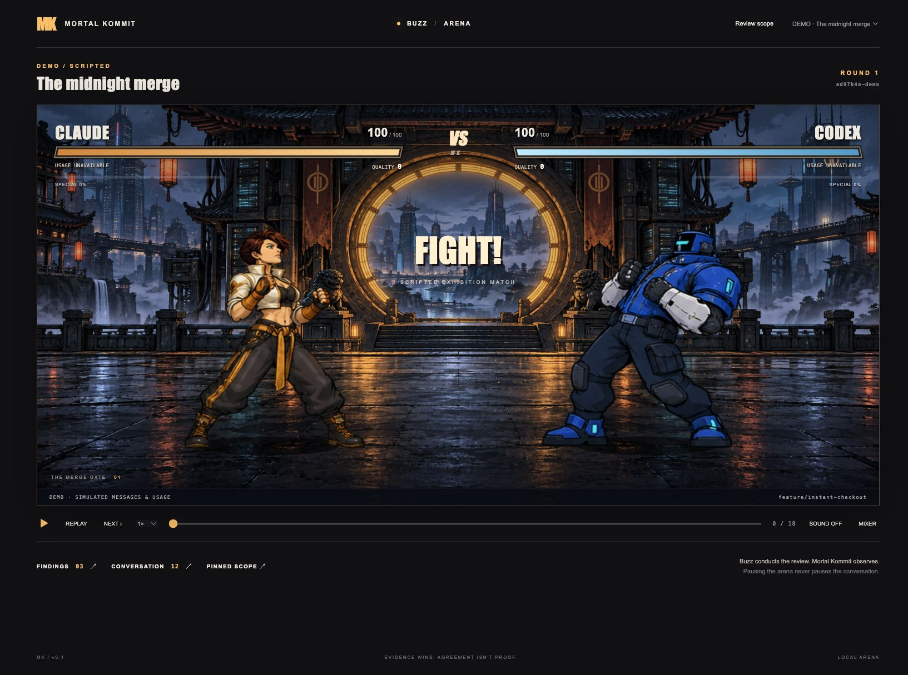
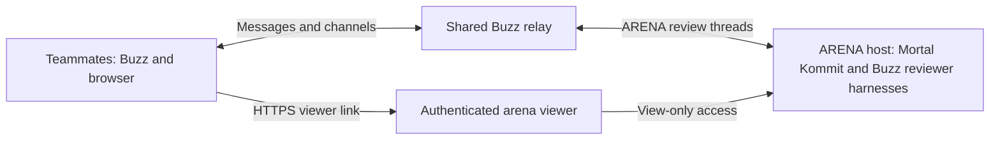

# Mortal Kommit

Buzz conducts the code review. Mortal Kommit turns the conversation into an arcade fight.

Post a GitHub PR or GitLab MR in a shared Buzz **ARENA** channel. Your team can request reviews, follow the reviewers’ reasoning, inspect evidence, and replay the result.

An installable Node CLI, persistent local ARENA listener, and React/Canvas browser arena with original sprite atlases, synthesized chiptune music, evidence-linked combat, token fatigue, replays, and Markdown/JSON exports.



## Install and play

Requires Node 22.13 or newer. From this source directory:

```sh
npm ci
npm run build
npm pack
npm install -g ./mortal-kommit-0.1.0.tgz
mortal-kommit --demo
```

The demo is deterministic and explicitly labeled. It uses no model calls. It covers attacks, duplicate blocks, challenges, a successful rebuttal, a unique substantiated special, a retraction, score corrections, supporting evidence, measured fixture usage, fatigue, and final results.

The installed command can run from any repository; browser assets resolve from the installed package. The server binds to loopback and stays running until `mortal-kommit arena stop`. Its private authenticated URL is printed by the CLI.

## Live Buzz setup

The integration targets the inspected macOS Buzz 0.5.23 CLI and `buzz-acp` harness, with its installed Claude and Codex ACP adapters. Mortal Kommit does not implement another agent conversation loop.

### Host prerequisites and reviewer identities

Live reviews currently require **one Claude reviewer and one Codex reviewer**. You can select the model within each integration; arbitrary provider pairs, two Codex reviewers, or selecting existing Buzz agents by name are not supported in this release.

Install and authenticate the following on the **ARENA host** before setup:

- Node 22.13+, Git, and the Buzz CLI (`buzz`).
- Buzz's `buzz-acp` harness and both ACP adapters: `@agentclientprotocol/claude-agent-acp` and `@agentclientprotocol/codex-acp`.
- Claude and Codex provider tooling with working authentication. The Codex CLI is also used for neutral preparation and independent analysis.
- `gh` for GitHub PRs or `glab` for GitLab MRs, authenticated for the relevant host, plus working Git fetch access.

Installing the Mortal Kommit npm package does not install or authenticate Buzz or its provider integrations. The demo does not need them. Defaults expect the macOS Buzz installation; see [host paths and model discovery](docs/configuration.md#host-tooling-and-authentication-paths) when your installation differs.

Setup provisions **ArenaClaude** and **ArenaCodex** as dedicated Buzz identities. It reuses the host's provider authentication, not existing personal agents' identities or model selections. Authentication directories default to `~/.claude-work` / `~/.codex-work` when present, otherwise `~/.claude` / `~/.codex`; set `profiles` explicitly for another account or directory. The `-work` names are directory conventions, not required account types.

**The ARENA host needs `buzz-acp`; a separate relay server and teammates' computers do not need it for Mortal Kommit.** Mortal Kommit starts and stops its own restricted reviewer harness processes. Do not manually launch a second harness for these identities.

### Choose the models

Edit the host's `~/.local/share/mortal-kommit/config.json` (or `config.json` under `MORTAL_KOMMIT_DATA_DIR`). Merge this `models` object into the existing configuration, preserving the other fields:

```json
{
  "models": {
    "claude": "YOUR_CLAUDE_MODEL_ID",
    "codex": "YOUR_CODEX_MODEL_ID",
    "analysis": "YOUR_CODEX_ANALYSIS_MODEL_ID"
  }
}
```

These are **placeholders**: replace them with model IDs supported by the installed adapters and your accounts. [Model discovery instructions](docs/configuration.md#choosing-models) explain how to query Buzz's installed adapters. `claude` and `codex` select the two fighters; `analysis` selects the Codex model used for both scouting and the separate conversation analyzer. Its usage is excluded from fighter fatigue.

All three overrides are optional. With `"models": {}`, Mortal Kommit sends no explicit model selection and leaves it to the harness/adapter or Codex CLI defaults, including applicable host environment settings. It does **not** import model choices from personal Buzz agents. Explicit IDs make the host's intended choices clear.

These settings apply to the host's reviews; there is no per-request model flag or channel command. Let any active review finish, then restart the listener after editing (`mortal-kommit arena stop`, followed by `mortal-kommit arena start --background` in the environment containing its credentials).

### Provision and start ARENA

```sh
mortal-kommit doctor
```

`doctor` checks tooling, adapter files, and provider login status. It does not verify access to every configured model or successful Buzz relay authorization.

Supply the existing identity key of the Buzz user who will own the arena agents through `MORTAL_KOMMIT_OWNER_KEY` (hex or nsec), using your preferred secure environment/credential manager. This identity must be admitted to the relay and allowed to create/manage ARENA; it is not the relay server's signing key. Do not put it in this repository or browser configuration. The backend needs owner authorization to provision the private channel and decrypt optional NIP-AM usage events. A running daemon inherits its startup environment; restart it after setting credentials.

```sh
mortal-kommit arena stop
mortal-kommit arena setup
mortal-kommit repo add my-repo /absolute/path/to/my-repo
mortal-kommit arena start --background
```

Setup creates/reuses a private **ARENA** channel and provisions the dedicated stable Claude/Codex pair described above. Existing Buzz agents are preserved. The listener persists, while the pair's restricted harness processes are started for each match and stopped after both final reviews. One match runs at a time for the pair; additional requests queue in separate threads.

**Before posting a PR or MR in ARENA, register its target repository on the machine running the listener.** See [repository registration](#register-repositories-on-the-arena-host) for complete GitHub and GitLab examples. A link alone does not clone or register a repository.

From your repository:

```sh
mortal-kommit
mortal-kommit --base main
mortal-kommit --pr https://github.com/owner/project/pull/42
mortal-kommit --mr https://gitlab.example.com/team/project/-/merge_requests/42
mortal-kommit --token-budget 80000 --no-open
```

Any human member of ARENA can request a review by posting a new topic:

```text
!review --repo my-repo
!review --repo my-repo --base main
!review --pr https://github.com/owner/project/pull/42
!review --mr https://gitlab.example.com/team/project/-/merge_requests/42
```

Pasted PR/MR links also work when Buzz wraps them as Markdown autolinks (`<https://…>`).

Owners, admins, members, and guests can submit requests. Bot accounts and delegated agent identities cannot start reviews. The listener checks current channel membership and identity metadata, acknowledges accepted requests in their thread, and queues them for the dedicated pair. Membership is checked again before preparation and kickoff. A teammate uses a repository alias registered by the host; they do not need the host's Buzz key or local CLI setup.

Shared arena links allow viewing and exports. For a permanent team address, configure `viewer.publicUrl` and put its viewer listener behind your HTTPS reverse proxy; see [server and container hosting](docs/deployment.md#permanent-hosting). For a temporary remote preview, run `mortal-kommit tunnel`. New Buzz review links use the configured viewer automatically. With neither option enabled, links work on the host machine. Local service controls use a separate credential.

For a shared team installation, see [team deployment](#team-deployment-relay-and-arena-hosting). The Buzz relay URL and the browser arena URL are separate addresses; setting one does not publish the other.

Both fighters get the same pinned source and neutral Codex scouting packet. Claude's kickoff starts exactly `review this with codex.`; Codex's starts exactly `review this with claude.`. Buzz delivers their exchanges. The independent analyzer only reads and classifies the conversation.

Replays preserve substantive claims, challenges, and concessions even when the final review is clean. These exchanges show their source messages and animate without points or damage; supported findings and validated usage retain the separate scoring rules. Playback uses saved events and makes no model calls.

**Verification status:** a real GitLab review completed through Buzz with both restricted reviewers. Token accounting, replays, combat, audio, and exports have been exercised. GitHub revision selection and discussion retrieval are tested separately from the shared review pipeline. See [verification](docs/verification.md) for the precise scope and limitations.

## Team deployment: relay and arena hosting

One shared Buzz community can host your team's channels, including ARENA. Teammates connect their Buzz clients to that community and open review links in their browsers. **Only the ARENA host needs Mortal Kommit, repository clones, GitHub/GitLab access, and the configured model integrations.** Teammates do not each install or run Mortal Kommit.



The ARENA host is a separate service from the relay. They may share a machine, or the ARENA host can connect to a relay on another server. Installing the relay alone does not install the reviewers or host the arcade. An always-on host removes the dependency on a developer's laptop staying awake. Live reviewer integration is currently verified on macOS with Buzz 0.5.23; running the entire stack on a Linux relay server still needs compatible harness/adapter paths and live validation.

There are **two URLs to configure or share**:

| Address          | Purpose                                      | Current setup                                                                                                                                                                           |
| ---------------- | -------------------------------------------- | --------------------------------------------------------------------------------------------------------------------------------------------------------------------------------------- |
| Buzz relay URL   | Team chat, channels and agent messages       | Configure Mortal Kommit's `relay` as your community's `wss://…` URL, and connect the team's Buzz clients to that community. On first setup, `BUZZ_RELAY_URL` also supplies the default. |
| Arena viewer URL | Live animation, evidence, replay and exports | Configure `viewer.publicUrl` for permanent hosting, or run `mortal-kommit tunnel` for an ngrok preview. Both provide authenticated links for Buzz review threads.                       |

Both addresses must be reachable by their intended users. `localhost` in a teammate's browser refers to **their own machine**, not the ARENA host. A corporate VPN can make a private service reachable; an internet deployment needs an authenticated HTTPS endpoint. Relay access and website access are separate: joining ARENA does not automatically authenticate the browser viewer.

**Permanent hosting:** merge this into the host's existing `config.json`, replacing the example URL with your own:

```json
{
  "viewer": {
    "publicUrl": "https://arena.example.com",
    "host": "127.0.0.1",
    "port": 8787
  }
}
```

Run `mortal-kommit arena start` in the foreground under your service supervisor, or add `--background` for a local installation. The same process now serves a separate **view-only HTTP listener on port 8787**. Route your HTTPS hostname to that port through nginx or another reverse proxy. Buzz review links use the configured URL automatically; `mortal-kommit viewer url` prints the authenticated link. DNS, proxy routing, TLS certificates and access policy are supplied by your deployment.

For containers, environment variables `MORTAL_KOMMIT_PUBLIC_URL`, `MORTAL_KOMMIT_VIEWER_HOST`, and `MORTAL_KOMMIT_VIEWER_PORT` override the corresponding settings. Bind the viewer to `0.0.0.0` inside a container and publish only its port to the proxy. The administrative listener always stays on loopback. See [deployment instructions](docs/deployment.md#permanent-hosting), the [nginx example](docs/deploy/nginx.conf.example), and the [Dockerfile](docs/deploy/Dockerfile). The image supports the web/demo runtime; live reviews additionally need the Buzz/provider tooling and authentication described above.

**Temporary preview:** leave `viewer` unset/null, run `mortal-kommit arena start --background`, then `mortal-kommit tunnel` before requesting a review. The ngrok option remains available for demos; it is not needed for permanent hosting. Stop any existing tunnel before switching to permanent hosting.

Viewer links grant access to the instance's stored review material and exports. Keep them within the intended team, and register only repositories those viewers and ARENA members may access. Link possession is not per-person Buzz authentication; removing a channel member does not revoke a previously shared viewer link. Permanent viewer keys survive restarts; `mortal-kommit viewer rotate-key` invalidates old links and disconnects existing viewer streams. Restarting an ngrok tunnel rotates its separate key.

## Review scope

- Default: fetch the configured upstream into an application-owned bare repository; review only commits ahead of that upstream. Published commits already on the upstream are excluded.
- Missing upstream, detached HEAD, failed refresh, divergence, and an empty range produce explicit errors. No default branch guess is made. Use `--base` when you intend another comparison.
- `--base`: compare the merge-base of the explicit revision and local HEAD to HEAD; print the immutable comparison and selected commits.
- `--pr`: use authenticated `gh` for GitHub or GitHub Enterprise. Fetch the target repository’s `refs/pull/N/head` (including fork PRs), pin its exact head and target, and review the unique merge-base-to-head change. Recheck for force pushes and retargeting. Include bounded conversation comments, review summaries, and relevant inline comments. The local clone’s origin must match the PR’s target repository.
- `--mr`: use authenticated `glab` for GitLab or a self-hosted instance. Fetch the MR head and target, pin GitLab's `base_sha`/`head_sha`, recheck revision consistency, and include bounded relevant discussion. The local repository must match the MR's target project. Separate SSH hosts are recognized through the operator's global `glab` `ssh_host` setting for the MR hostname; the complete project path must still match.
- Uncommitted and untracked changes are excluded and reported. Checkout, index, local refs, and existing worktrees are preserved.

Source is read through bounded snapshot capabilities. Reviewers have no shell, write, arbitrary filesystem, or unrelated Buzz tools. Repository instructions and PR/MR text are review material. Reproduction execution is not provided in this release.

## Register repositories on the ARENA host

The host must have a local clone of each repository and permission to fetch it. Register the **target** repository, including for PRs/MRs from forks; the clone's `origin` must match the repository in the review URL. This is a one-time setup **per repository on the host**, not per teammate or per review. Channel members do not need their own local clone or provider credentials.

Choose a short alias and an absolute local path. The alias is used by `!review --repo`; PR/MR links find the matching registered `origin` automatically. If the repository is already cloned, skip the clone command and register its existing path.

### GitHub

```sh
gh auth login --hostname github.com
gh auth status --hostname github.com
gh repo clone owner/project /absolute/path/to/github-project
mortal-kommit repo add github-project /absolute/path/to/github-project
mortal-kommit arena stop
mortal-kommit arena start --background
```

Then post a **new topic** in ARENA:

```text
!review --pr https://github.com/owner/project/pull/42
```

For GitHub Enterprise, authenticate `gh` against that hostname and use the target repository's Enterprise clone URL and PR URL.

### GitLab, including self-hosted instances

```sh
glab auth login --hostname gitlab.example.com
glab auth status --hostname gitlab.example.com
# Use the target project's SSH or HTTPS clone URL from GitLab.
git clone git@gitlab.example.com:team/project.git /absolute/path/to/gitlab-project
mortal-kommit repo add gitlab-project /absolute/path/to/gitlab-project
mortal-kommit arena stop
mortal-kommit arena start --background
```

Then post a **new topic** in ARENA:

```text
!review --mr https://gitlab.example.com/team/project/-/merge_requests/42
```

Replace `gitlab.example.com` with `gitlab.com` or your self-hosted hostname, and preserve any nested group path. If the SSH hostname differs from the web/API hostname, use GitLab's advertised clone URL and the operator's global `glab` `ssh_host` mapping described in [configuration](docs/configuration.md).

For either provider, normal Git SSH/HTTPS authentication must work as well as API authentication. Credentials stay on the host; a service account is optional for a shared team host. Restart from the environment containing `MORTAL_KOMMIT_OWNER_KEY`, after any active review completes. Registration updates the config file; an already-running listener loads it on restart.

**“Repository is not registered locally.”** Register the matching target clone using `mortal-kommit repo add <alias> <absolute-path>`, then restart the listener. Check the clone's origin with `git -C <absolute-path> remote get-url origin`. After fixing a rejected request, submit it as a new ARENA topic; old rejected messages are deduplicated and are not automatically retried.

## Actual source access

Both reviewers get the same committed **base and head source snapshots**, not just a diff. They can list files, read numbered source lines, and search for callers, tests, configuration, and dependencies through backend-enforced read-only tools. Scouting supplies a neutral starting map; reviewers can investigate beyond it. The user's working tree is never their execution directory.

Context is bounded: secret-like files, generated content, binaries, symlinks, submodules, oversized files, and files exceeding snapshot limits are omitted and reported. This release does not install dependencies, execute tests, or give agents a shell. See [configuration](docs/configuration.md) for authentication and [architecture](docs/architecture.md) for the precise limits.

## Browser controls

Click **ENTER ARENA** to enable audio. Space pauses presentation, M mutes, F opens findings, C opens conversation, Escape closes a drawer, and Right Arrow advances the replay. Native button/slider keyboard controls remain available. Mixer controls separate music/effects volume and reduced motion. Pausing the animation does not pause Buzz.

Winning reviews end with a cinematic finisher: **CONTEXT COLLAPSE** for Claude (amber vortex palm strike), **FORCE PUSH: ORBITAL** for Codex (rocket uppercut). The recorded knockout decides first; otherwise review-quality points decide. Equal quality scores produce an **HONORABLE DRAW**. Finishers celebrate the result without altering measured health, tokens, or findings. Existing winning replays upgrade automatically.

Strikes close to frame-defined contact points, with hit pauses, recoil, sparks, combos and contact-timed sound. Paused timeline scrubbing previews the contact pose; playback speed applies to both sprite motion and event pacing. Reduced motion keeps readable poses without camera movement, launch effects or flashes.

Click a combat caption or history entry for its source messages, finding evidence, or usage record. The ledger retains retractions and unresolved disagreements. Agreement between agents is not treated as proof. Review quality is separate from health.

```text
fatigue = weight × clamp(reviewTokens / allowance, 0, 1)
health  = clamp(100 − combatDamage − fatigue, 0, 100)
```

Default allowance is 100,000 tokens per fighter and weight is 30 health. This is a fatigue allowance, not a provider spending cap. Missing telemetry reads **USAGE UNAVAILABLE**. Reported and derived/partial accounting are labeled. Completed-turn reports are persisted locally; provider records fill the installed Codex adapter’s partial-turn accounting. Cached input counts once. Preparation and analyzer usage are separate. An arcade knockout does not stop the Buzz review.

## Replay, export, remote preview

```sh
mortal-kommit replay <match-id>
mortal-kommit export <match-id> --format md --output review.md
mortal-kommit export <match-id> --format json --output review.json
mortal-kommit tunnel
mortal-kommit tunnel stop
```

`tunnel` uses your installed, authenticated ngrok. It starts a separate authenticated viewer gateway with its own capability link. Viewing, replay, and exports are available remotely; request reviews through Buzz or the local CLI, and control the service locally. It disables ngrok request inspection. Anyone with the full viewer link can read persisted review material exposed by the arena, so share it only with intended testers. Keep the Mac awake and both services running. Restarting the ngrok tunnel rotates its capability. Service restarts are discovered automatically by the gateway.

Data is stored locally in `~/.local/share/mortal-kommit`, or `MORTAL_KOMMIT_DATA_DIR`. SQLite holds messages, findings, normalized usage, and combat events; snapshots and packets are stored per match. Replays and browser refreshes make no model calls.

## Development and documentation

```sh
npm run typecheck
npm test
npm run build
node dist/cli.js assets validate
```

- [Contributing](CONTRIBUTING.md) · [Security](SECURITY.md) · [Release checklist](docs/releasing.md)
- [Configuration and troubleshooting](docs/configuration.md)
- [Team deployment and shared hosting](docs/deployment.md)
- [Architecture, scoring, telemetry, and security boundaries](docs/architecture.md)
- [Replaceable sprite assets and generation prompts](docs/assets.md)
- [Asset license manifest](docs/asset-licenses.md)
- [Verification and known limitations](docs/verification.md)

MIT licensed. An independent project, not affiliated with Block, Anthropic, OpenAI, GitHub, or GitLab. Claude, Codex, and Buzz names identify integrations; the fighter designs and soundtrack are original.
